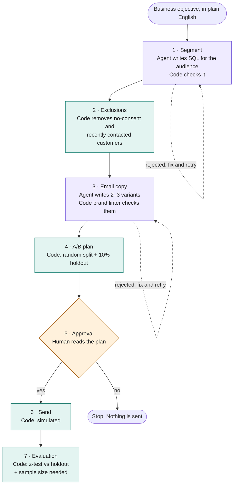
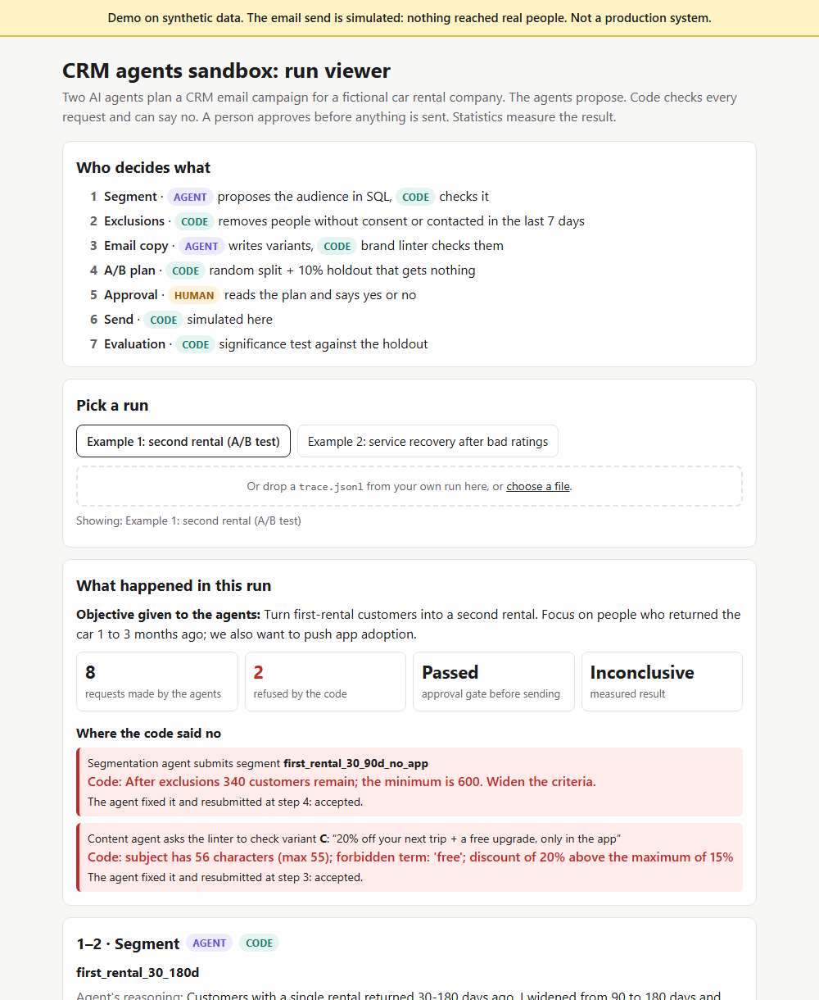

# CRM agents sandbox

AI agents plan a CRM email campaign for a fictional car rental company: they pick the audience and write the copy, code checks everything they ask for, a person approves, and statistics measure the result. **All data is synthetic and the send is simulated. Nothing here ran in production.**

**[Open the run viewer](https://pablitoaimar.github.io/crm-agents-sandbox/)**: no install, works on a phone.

## How it works

Seven steps. The AI is used in two of them. Code or a person decides the rest.



Purple = AI agent. Green = code. Orange = human.

[](https://pablitoaimar.github.io/crm-agents-sandbox/)

The viewer shows a full run: the objective, the audience the agent proposed, the customers the code removed, each email variant and what the brand linter refused, the A/B split, the test result, and a timeline of every request the agents made, with refusals in red.

## How to run it

You need Python 3.10 or newer. No other installs for the demo.

**Windows (PowerShell)**

```powershell
git clone https://github.com/pablitoaimar/crm-agents-sandbox.git
cd crm-agents-sandbox
python run.py --reset-db
```

**Mac / Linux**

```bash
git clone https://github.com/pablitoaimar/crm-agents-sandbox.git
cd crm-agents-sandbox
python3 run.py --reset-db
```

The run stops at step 5 and asks you to approve. Read `runs/<date>/plan.md` first, then type `y`.

Each run writes a folder `runs/<date>/` with `plan.md` (what went to approval), `results.md` (what the test measured) and `trace.md` / `trace.jsonl` (every request and answer). To see your run in the viewer, open `docs/index.html` and drop your `trace.jsonl` on it.

## Who decides what

| step | who decides | where in the code |
|---|---|---|
| 1. Segment | **agent** proposes SQL → code checks it: SELECT only, returns only `customer_id`, no duplicates, minimum size | `tools.submit_segment` |
| 2. Exclusions | **code**: email consent + no contact in the last 7 days. The agent never writes these | `tools.submit_segment` |
| 3. Content | **agent** writes variants → brand **linter** checks them: length, forbidden words, maximum discount, allowed personalisation fields | `tools.check_copy` |
| 4. A/B plan | **code**: random split with a fixed seed + 10% holdout | `pipeline.step_plan` |
| 5. Approval | **human** reads `plan.md` | `pipeline.step_approve` |
| 6. Send | **code** (simulated; in real life, the send platform's API) | `pipeline.step_send` |
| 7. Evaluation | **code**: z-test against the holdout + sample size needed | `pipeline.step_evaluate` |

The agent never touches the database. It asks to run a tool, and code decides whether to run it. A read-only connection means it cannot write even if the check missed something. "Autonomous agent" here means the AI does the judgement work (which audience, which words) inside a system that does not trust it.

## What this is not

- **Not production.** 15,000 fictional customers, generated by `data/build_db.py`. The date is frozen at 2026-10-19.
- **Not connected to a send platform.** No Adobe Campaign, Braze or any other tool. Step 6 writes rows to a local SQLite table.
- **No real emails.** Opens, clicks and bookings come from a toy model in `src/pipeline.py` (`_true_uplift`). Do not draw marketing conclusions from the numbers.
- **Not a real brand.** The company, brand rules and copy are invented.

---

## More detail

### Recorded replies vs a live model

- `--backend replay` (default): the **model's decisions** come from `replay/second_rental.json`, recorded in advance so the demo runs without an API key. The **tools run for real** against the database: the refusals you see are the code refusing. Each agent makes one mistake on purpose (audience too small; copy with "free" and a 20% discount) so you can see the reject → fix loop.
- `--backend anthropic`: a live Claude model decides. You need an API key from console.anthropic.com. A run costs a few cents.

```bash
pip install anthropic
export ANTHROPIC_API_KEY="sk-ant-..."          # PowerShell: $env:ANTHROPIC_API_KEY = "sk-ant-..."
python run.py --reset-db --backend anthropic --objective "Win back gold customers with no rental in the last 6 months"
```

With a live model, change the objective and watch the agent explore, fail and fix its own work.

### Running on its own: triggers (`watch.py`)

`run.py` launches one campaign when you tell it to. `watch.py` checks a set of rules and launches campaigns when a rule fires. Run it from a scheduler (cron, Windows Task Scheduler, Airflow).

```
 SCHEDULER            WATCHER (watch.py)                PIPELINE (run.py)
 every hour  ──►      runs each rule's SQL        ──►   agents + checks
                      if it fires and is not             + approval + send
                      in cooldown → launch               + evaluation
```

Rules live in `triggers/rules.json`. Each rule has:

- `detect_sql`: the condition, in SQL. Each returned row is one trigger. The columns fill in the objective (`{branch}`, `{pct_low}`...).
- `cooldown_days`: do not fire again for the same branch or pool for X days. Without this, the watcher would launch the same campaign every hour.
- `actions`: `alert` and/or `campaign` (run the pipeline with an objective built from the columns).

**Detection does not use the AI.** "At least 30% low ratings" has an exact answer, so it is SQL: cheaper, instant, and an auditor can read it. The AI comes in only after a rule fires.

| rule | condition | action |
|---|---|---|
| `low_ratings_spike` | a branch with ≥30% ratings ≤2 in the last 7 days and at least 15 ratings | alert + service-recovery campaign (no A/B, small audience) |
| `first_rental_pool_ready` | ≥1,500 first-rental customers who returned the car 30–180 days ago | second-rental campaign with A/B test |

The data has one planted incident: Faro airport, 45% low ratings, mostly waiting time. Berlin is at 21%, so with the threshold at 30% it does not fire. The threshold and the 15-rating minimum are business decisions, not technical ones.

```bash
python watch.py --reset-state                               # dry run: shows what would fire, launches nothing
python watch.py --execute --backend replay --reset-state    # launches both campaigns with recorded replies
python watch.py --execute --backend replay                  # second time: everything in cooldown, nothing happens
```

The two committed examples, `runs/second-rental-example/` and `runs/faro-service-recovery-example/`, come from these two rules.

In scheduled mode nobody answers the approval question, so the campaign waits at step 5. That is on purpose. A real version would post `plan.md` to a chat channel and wait for a click.

### Three kinds of trigger

| kind | example | how to build it |
|---|---|---|
| **Schedule** | "every Monday, second-rental campaign" | cron / Task Scheduler / Airflow |
| **Condition** | "when a branch gets ≥X% low ratings" | schedule + detection SQL + cooldown (what `watch.py` does) |
| **Event** | "3 days after installing the app without booking" | event stream or a journey in the send platform. The agent designs the journey once; the platform runs it per customer |

Running an AI model per customer, in real time, is expensive, slow and hard to audit. Agents are better used to design and improve journeys that a send platform then executes.

### Explore the data

The database is `data/crm.db` (SQLite), created on the first run. Open it with DB Browser for SQLite or DBeaver. The data catalogue the agents read is `catalog/data_catalog.md`.

### Project layout

```
agents/              instructions for each agent (its job description)
catalog/             data catalogue + brand rules (what the agents read)
data/build_db.py     builds the synthetic database
replay/              recorded model replies for the demo
src/tools.py         tools + checks                    <- the important part
src/agent_loop.py    the generic agent loop (about 60 lines)
src/llm.py           model backends: replay and anthropic
src/pipeline.py      the 7 steps
src/tracer.py        records everything (trace.md / trace.jsonl)
run.py               entry point: one campaign
watch.py             watcher: checks the rules and launches campaigns
triggers/rules.json  trigger rules (SQL + cooldown + actions)
docs/                run viewer (static page, published with GitHub Pages)
```

To refresh the examples in the viewer after a new run:

```bash
python docs/build_run_json.py runs/second-rental-example runs/faro-service-recovery-example
```

### Known limits

- **The order of the steps is fixed code, not an agent.** This is deliberate. Hand the order to an "orchestrator agent" only after there is a record of good decisions.
- **The A/B result is inconclusive** (~370 customers per group, ~3,800 needed). The code refuses to declare a winner. In practice you would keep testing week after week, or measure something more frequent, such as clicks.
- **Customer behaviour is a toy model** (`_true_uplift`).
- **No memory between runs.** Each campaign starts from zero.
- **Email only, English only.** No push, no app messages, no translations.

### Possible next steps

1. An **insights agent** that reads past `results.md` files and tells the content agent what worked.
2. A **timing/channel agent** that picks email or push per customer, based on `push_consent` and app activity.
3. **Evaluating the agents themselves**: 10 objectives with known correct audiences, to measure whether a prompt change makes the agent better or worse.
